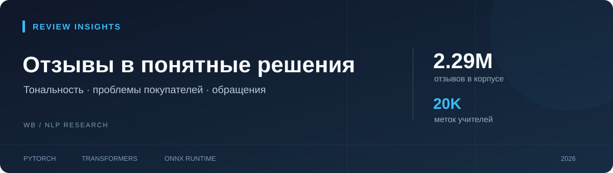
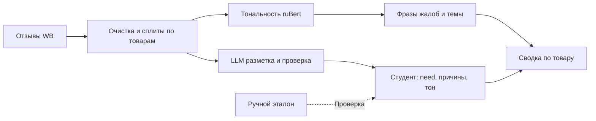

# Аналитика отзывов для продавца Wildberries

**Какие проблемы повторяются у покупателей и где нужен ответ человека?**
Проект превращает отзывы в сводку по товару: тональность, темы жалоб и обращения для продавца.

[Пример отчёта](reports/product_report.html) · [Демо по 4 товарам](reports/demo_maternity.html) ·
[Метрики](reports/eval.md) · [Продолжение обучения](docs/project_status.md)


## Возможности

- **Сводка по товару:** распределение тональности и частые проблемы с примерами отзывов.
- **Приоритетные обращения:** модель выделяет отзывы, где может понадобиться живой человек.
- **Разбор ответов продавца:** в демо показаны шаблонные, индивидуальные ответы и обращения без ответа.

Продавец отвечает сам. Автоматической отправки или генерации ответов в текущем продукте нет.

## Попробовать свои отзывы

Из настроенного окружения, с локальными весами в `data/student/model`:

```bash
python run.py
```

Локальная страница: `http://127.0.0.1:7865`. Загрузите CSV, выберите колонку с текстом
и нажмите «Анализировать». [Пример CSV](examples/demo_reviews.csv). Поддерживаются UTF-8 и Windows-1251,
разделители запятая, точка с запятой и табуляция; до 5000 строк и 20 МБ.
Обработка выполняется на CPU этого компьютера. Исходный файл не изменяется.
Можно скачать CSV с прогнозами и самостоятельный HTML-отчёт. Это прогнозы модели, не подтверждённые
решения продавца; порог кандидата регулируется, причины отмечаются при score ≥ 0.5.

Проверка готовности без загрузки модели: `python run.py --check`.
Разметка: `python run.py --app annotate` (порт 7864).
В существующей Windows-установке без активации окружения:
`..\ru-review-sentiment\.venv\Scripts\python.exe run.py`.

**Сколько читать продавцу:** на изученной выборке из 101 ручной метки при пороге 0.85 на просмотр
попадает 12 отзывов, но 3 нужных обращения пропускаются. Эти числа не оценивают будущую частоту
обращений магазина. [Полная таблица порогов и ограничений](reports/seller_workload.md).

## Результаты

| Проверка | Результат | Условия |
|---|---|---|
| Тональность WB | **0.610 → 0.663 macro-F1** | До и после адаптации, полный WB-test, 221 550 отзывов |
| Независимый RuReviews | **0.736 → 0.765 macro-F1** | 14 786 отзывов на товары |
| Тональность ONNX int8 | **0.663 macro-F1** | Тот же полный WB-test |
| Нужен человек | **0.674 F1** | Согласие с 2 000 меток учителей, порог 0.35 |

Разбиение сделано **по товарам**: один товар не попадает одновременно в обучение и тест.
Полные сравнения: [тональность](reports/eval.md), [учителя](reports/teacher_labels.md), [студент](reports/student.md).

**Ограничение:** на 101 ручной метке пользователя need имеет precision 38%, recall 67% при пороге 0.35.
Согласие с LLM-учителем выше, чем с человеком; перед применением модель требует улучшения.

## Как устроено



Основа — [модель тональности русских отзывов](https://github.com/savocheek/sentiment-analysis-ru).
Темы: эмбеддинги `rubert-mini-frida` и KMeans. Для необходимости ответа отдельный ruBert-base обучен
на 20 тыс. меток LLM-учителей: need, 8 причин, 4 тональности.

## Пример результата

[HTML-отчёт](reports/product_report.html) показывает доли проблем и цитаты покупателей.
Скачайте файл и откройте в браузере: GitHub отображает исходный HTML.
Для демо товаров для беременных собраны **4 товара и 825 отзывов**:
[HTML](reports/demo_maternity.html), [JSON](reports/demo_maternity.json), [скрипт](scripts/demo_maternity.py).
Темы и подтверждающие цитаты скрыты до перепроверки: аудит обнаружил ошибки отрицаний и соответствия размера.
Остальные результаты модели помечены как предсказания. Для просмотра скачайте HTML и откройте в браузере.

## Запуск

```bash
python -m venv .venv
# Windows PowerShell: .venv\Scripts\Activate.ps1
# Linux / macOS: source .venv/bin/activate
pip install -r requirements.txt
python prepare_data.py
```

Это подготовка данных: скачиваются два шарда WB и RuReviews. Для обучения нужны локальные веса
исходного ученика в `../ru-review-sentiment/model`. Дальнейшие команды: [подробный обзор](docs/experiments.md#запуск).
Перед `train_student.py` сохраните текущие веса: скрипт перезаписывает результат.

## Продолжение

На **11 ноября 2026** сохранена 101 ручная метка и подготовлены **150 новых отзывов**.
Слепой интерфейс разметки обновлён: `python needs_reply_label.py`. Отдельный `train_manual.py` поддерживает
экспериментальное дообучение по ручным исправлениям с защитой исходных весов. Подготовка без обучения:
`python train_manual.py --output data/manual_runs/prepared-01 --prepare-only` (нужен новый каталог).
Следующий шаг — разметить подборку и согласовать спорные критерии. [Подробности](docs/project_status.md).
Нейтральность — слабый класс; названия кластеров требуют утверждения. Дат отзывов нет, динамика не рассчитывается.

| Документация | Содержание |
|---|---|
| [Состояние проекта](docs/project_status.md) | Веса, разметка и порядок продолжения |
| [Аудит данных](reports/data_audit.md) | Повторная проверка метрик и подготовка ручного эксперимента |
| [Нагрузка продавца](reports/seller_workload.md) | Просмотр и пропуски при разных порогах |
| [Подробный обзор](docs/experiments.md) | Данные, этапы и команды |
| [Инструкция разметчика](docs/needs_reply.md) | Причины проблемы и необходимость ответа |
| [Кривая обучения](reports/student_curve.md) | Сравнение объёма псевдоразметки |
| [Темы жалоб](reports/topics.md) | Кластеры и примеры |

**Данные:** [WB](https://huggingface.co/datasets/nyuuzyou/wb-feedbacks) — CC0 1.0;
[RuReviews](https://huggingface.co/datasets/ai-forever/ru-reviews-classification) — Apache-2.0.
Датасеты, веса и логи остаются вне Git. Метрики приведены по сохранённым экспериментам.
